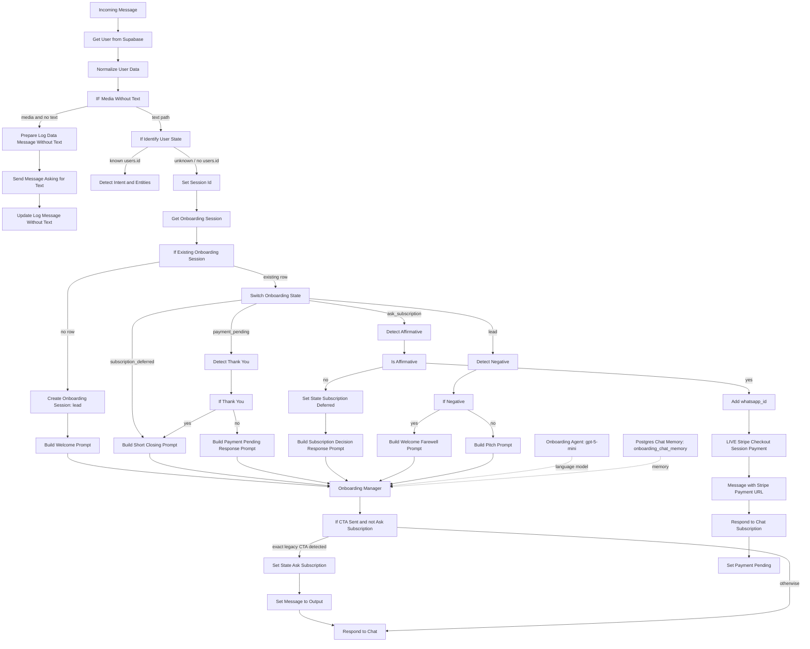
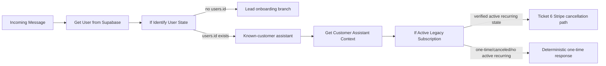

# Onboarding / Sales Engine v3 — Current-Architecture Audit

**Audit date:** 2026-08-11  
**Canonical workflow:** `n8n/Dietavity live 2.5.1 (Ticket 6).json`  
**Scope:** Read-only audit of the pre-purchase WhatsApp onboarding/sales path and its immediate payment, persistence, setup, and legacy-cancellation boundaries.  
**Change status:** No workflow, prompt, SQL, schema, test, application, Stripe, Twilio, or production change was made. This report is the only audit deliverable.

## 1. Executive summary

The current pre-purchase system is a small, deterministic state router wrapped around an LLM response generator. Unknown WhatsApp senders are identified by absence from `users`, assigned an `onboarding_sessions` row keyed by normalized WhatsApp number, and routed by `onboarding_state`. An n8n Postgres chat-memory node stores conversational messages for the LLM, but the deterministic affirmative, negative, thank-you, and CTA checks do not consume that memory.

The most important finding is that Checkout authorization is too weak. There is one reachable path that creates and sends a Stripe Checkout Session URL, and it requires the stored state `ask_subscription`; however, within that state a current-message-only regex treats generic acknowledgements such as `ok`, `okay`, `vale`, `va`, `perfecto`, `excelente`, `genial`, `listo`, `dale`, `claro`, `sí`, `me interesa`, and others as sufficient authorization. The gate does not verify the previous assistant message, elapsed time, current offer, price, product, unresolved timing request, or explicit “buy/pay now” semantics. Therefore ambiguous short messages can authorize a commercial side effect.

The state model primarily represents funnel stage, not buyer intent. It cannot separately represent questions, objections, readiness, deferred timing, gratitude, or ambiguity. `subscription_deferred` exists, but it is entered for **every non-affirmative reply** in `ask_subscription`, not specifically for “buy later,” and all later messages in that state receive a generic short closing. It is therefore a terminal conversational bucket, not a usable deferred-intent/reminder representation. No reminder date or follow-up mechanism exists.

The active sales prompts are substantially obsolete. They advertise a `$99 MXN al mes` subscription, seven-day plans updated automatically each week, immediate start on subscription, and cancellation by sending `cancelar`. This conflicts with the live one-time Checkout branch, which correctly creates a 28-day-program payment session and validates `$149 MXN` (`14900` centavos). The payment-link message itself is current, but the conversation that authorizes it is not.

The historical failure described in the ticket is not fully reproducible in the current canonical graph: after an `ask_subscription` user says `recuérdame`, the current exact regex does not mark that message affirmative; it writes `subscription_deferred`, whose prompt forbids another CTA. An ensuing `ok` remains in the short-closing path and does not reach Checkout. Nevertheless, the root class of failure remains: if the session is still `ask_subscription`—including a stale session—`ok` directly creates and sends Checkout. Timing statements received while `lead` also go through `Build Pitch Prompt`, which is instructed to append the immediate subscription CTA.

The architecture around onboarding is healthier than the onboarding itself. Twilio ingress, normalized identity lookup, Supabase persistence, one-time Stripe Checkout creation and webhook verification, purchase persistence, post-purchase Setup, program lifecycle, Global Error Handler, paid-customer assistant, and Ticket 6 legacy cancellation are separable and should be preserved. Onboarding v3 should replace most of the lead-only sales branch rather than incrementally edit its copy and regexes. That replacement can stop at the unknown-user/known-user routing boundary and at the existing one-time Checkout service boundary, leaving Ticket 6 untouched.

### Priority conclusions

1. **High:** Generic acknowledgement in a stale/current `ask_subscription` session can create and send Checkout without explicit purchase intent.
2. **High:** Customer-facing sales prompts describe the wrong commercial product and terms.
3. **High:** Conversation stage and buyer intent are collapsed; timing, objections, questions, gratitude, and ambiguity lack durable representations.
4. **High:** The prompt forces an immediate CTA after almost every non-negative `lead` reply, including timing statements and questions.
5. **Medium:** The CTA-state protection condition is logically ineffective; it compares a boolean-like expression to the string `ask_subscription`, and its expression syntax lacks the leading `=` used by other n8n expressions.
6. **Medium:** Lead funnel events are only partially inferable. There is no durable event for explicit purchase intent or Checkout open, and unknown-lead messages are not written to `messages`.
7. **Medium:** No Meta Click-to-WhatsApp attribution field is persisted by the repository workflow.
8. **Recommendation:** Preserve surrounding infrastructure and substantially replace the pre-purchase lead branch. Do not alter the paid-user or legacy-cancellation branches.

## 2. Sources and audit method

Primary evidence:

- `n8n/Dietavity live 2.5.1 (Ticket 6).json` — node parameters, prompts, expressions, and graph connections.
- `database/dietavity-database-schema.sql` — authoritative checked-in table shapes and onboarding-state constraint.
- `server.js` and `views/setup.ejs` — post-purchase Setup and portal/start-date behavior.
- `test/ticket-s2-workflow.test.js` — one-time Checkout/purchase invariants.
- `test/ticket-6-legacy-cancellation-safety.test.js` and `docs/TICKET-6-LEGACY-CANCELLATION-SAFETY.md` — Ticket 6 isolation and safety boundary.
- `docs/TICKET-5-PAID-WHATSAPP-ASSISTANT.md` — paid-user assistant boundary.

The audit is static. It traces all graph connections that can reach the sales Checkout node, inventories exact node configuration and embedded code, and compares persisted fields with application behavior. It does not claim live n8n execution history, live database row contents, Twilio payload samples, Meta campaign data, or production configuration that is not present in the repository.

## 3. Current pre-purchase architecture

### 3.1 End-to-end diagram using actual node names



The known-user branch beginning at `Detect Intent and Entities` is the paid/customer assistant, not lead onboarding. It records messages and uses program/subscription context. The unknown-user branch does not use those message nodes.

### 3.2 Unknown-user routing

1. `Incoming Message` subscribes to Twilio event `com.twilio.messaging.inbound-message.received`.
2. `Get User from Supabase` queries `users.whatsapp_id` using `data.from` after removing `whatsapp:` and whitespace.
3. `Normalize User Data` returns the first row or `{}`.
4. `IF Media Without Text` diverts media-only traffic to a fixed request for text and an `unsupported_media` log.
5. `If Identify User State` checks whether `Get User from Supabase.item.json.id` is non-empty.
6. A known user takes the customer-assistant path. A sender with no `users` row takes `Set Session Id` → `Get Onboarding Session`.

This means “lead” is operationally defined as “no matching `users` row,” not by `onboarding_sessions.onboarding_state`. Successful one-time payment creates/resolves a `users` row, so subsequent inbound messages should route to the known-user assistant even if the onboarding session update failed.

### 3.3 Session and response path

- `Set Session Id` puts only the current Twilio `data.body` into `chatInput`.
- `Get Onboarding Session` reads by the same normalized WhatsApp number.
- Missing session: `Create Onboarding Session` inserts `lead`, then the welcome prompt runs.
- Existing session: `Switch Onboarding State` has explicit routes for `subscription_deferred`, `payment_pending`, `ask_subscription`, and `lead`.
- Prompt builders produce a dynamic system prompt; `Onboarding Manager` sends the current `chatInput` plus attached Postgres chat memory to `gpt-5-mini` with low reasoning effort.
- `If CTA Sent and not Ask Subscription` looks for one exact legacy CTA string in the LLM output. If found, it writes `ask_subscription` before `Respond to Chat`; otherwise it responds directly.

### 3.4 Requested node inventory

| Concern | Actual node(s) |
|---|---|
| Unknown-user routing | `Incoming Message`, `Get User from Supabase`, `Normalize User Data`, `IF Media Without Text`, `If Identify User State` |
| Onboarding session retrieval | `Set Session Id`, `Get Onboarding Session`, `If Existing Onboarding Session` |
| Onboarding memory | `Postgres Chat Memory`, table `onboarding_chat_memory` |
| State creation/update | `Create Onboarding Session`, `Set State Ask Subscription`, `Set State Subscription Deferred`, `Set Payment Pending`, `Mark Onboarding Session Subscriber` |
| Affirmative detection | `Detect Affirmative`, `Is Affirmative` |
| Negative detection | `Detect Negative`, `If Negative` |
| Thank-you detection | `Detect Thank You`, `If Thank You` |
| CTA detection | `If CTA Sent and not Ask Subscription` |
| Checkout creation/link delivery | `Add whatsapp_id`, `LIVE Stripe Checkout Session Payment`, `Message with Stripe Payment URL`, `Respond to Chat Subscription` |
| `payment_pending` | `Set Payment Pending`, plus `Switch Onboarding State` → `Detect Thank You` / payment-pending prompts |
| Farewell/closure | `Build Welcome Farewell Prompt`, `Build Short Closing Prompt`, `Build Subscription Decision Response Prompt`; no branch writes `closed` |
| AI prompt generation | `Build Welcome Prompt`, `Build Pitch Prompt`, `Build Welcome Farewell Prompt`, `Build Short Closing Prompt`, `Build Payment Pending Response Prompt`, `Build Subscription Decision Response Prompt`, `Onboarding Manager`, `Onboarding Agent` |
| Normal response delivery | `Respond to Chat` |
| Checkout-link delivery | `Respond to Chat Subscription` |

## 4. Current state machine

### 4.1 Durable and non-durable state concepts

The database constraint permits exactly:

```text
lead
ask_subscription
subscription_deferred
payment_pending
subscriber
closed
```

Additional workflow concepts:

- `pitch` is emitted as a field by `Build Pitch Prompt`, but is **not persisted** and is not accepted as a durable database state.
- `abandoned` is not present in the canonical workflow or schema constraint.
- `subscriber` is written after a verified, newly inserted one-time purchase, but is not an explicit `Switch Onboarding State` route because the newly created `users` row should route future messages away from onboarding.
- `closed` is schema-permitted but no canonical node writes it, and the switch has no route for it.

### 4.2 Transition diagram

```mermaid
stateDiagram-v2
    [*] --> lead: Create Onboarding Session
    lead --> lead: welcome response / negative farewell / pitch without exact CTA
    lead --> ask_subscription: LLM output contains exact legacy CTA
    ask_subscription --> payment_pending: current message matches affirmative regex; Checkout URL sent
    ask_subscription --> subscription_deferred: every non-matching message
    subscription_deferred --> subscription_deferred: every later message receives short closing
    payment_pending --> payment_pending: thank-you closing or payment-pending response
    payment_pending --> ask_subscription: possible if LLM emits exact legacy CTA because CTA guard is ineffective
    subscription_deferred --> ask_subscription: possible if LLM emits exact legacy CTA because CTA guard is ineffective
    lead --> subscriber: impossible directly
    payment_pending --> subscriber: verified new Stripe checkout.session.completed webhook
    subscriber --> [*]: future inbound resolves users row and bypasses onboarding
    closed --> [*]: schema-only; no writer/switch route
```



The two “possible” regression arrows depend on LLM noncompliance/hallucination; the shared CTA detector runs after every onboarding prompt, not just `Build Pitch Prompt`.

### 4.3 Per-state behavior

#### `lead`

- **Entry:** new `onboarding_sessions` row; default/schema state is also `lead`.
- **Expected purpose:** welcome, demonstrate value, answer initial questions, and progress toward offer.
- **Actual routing:** first message immediately gets `Build Welcome Prompt`. Later messages go to `Detect Negative`; exact negative gets a farewell, every other message gets `Build Pitch Prompt`.
- **Prompt:** welcome prompt on creation; pitch or welcome-farewell prompt thereafter.
- **Classifiers:** `Detect Negative`; after LLM response, exact CTA detector.
- **Writes:** session create; optional write to `ask_subscription` if exact CTA appears.
- **Commercial action:** no Checkout in the same execution. The LLM can produce the exact CTA, enabling generic affirmative Checkout on the next inbound message.
- **Actual transition defect:** negative farewell does not write `closed`, so the state stays `lead`; a later message restarts selling.

#### `ask_subscription`

- **Entry:** any onboarding LLM output contains exactly `¿Quieres suscribirte ahora por $99 MXN al mes?`.
- **Expected purpose:** wait for the user's subscription decision.
- **Actual routing:** current-message-only affirmative regex; true creates Checkout and sends its URL, false writes `subscription_deferred` before generating a response.
- **Prompt:** no LLM prompt on true; `Build Subscription Decision Response Prompt` on false.
- **Classifiers:** `Detect Affirmative` only. It does not run negative, thank-you, objection, question, or timing classification first.
- **Writes:** `payment_pending` after Twilio link-send node succeeds; otherwise `subscription_deferred` before the LLM response.
- **Commercial action:** true branch creates a live one-time Stripe Checkout Session and sends its URL.

#### `subscription_deferred`

- **Entry:** every non-affirmative reply while `ask_subscription`, including explicit “no,” a question, a price objection, “recuérdame,” gratitude, or unrecognized strong purchase wording.
- **Expected purpose by name:** interested, but not buying now.
- **Actual purpose:** generic terminal/closing bucket.
- **Actual routing:** every message goes directly to `Build Short Closing Prompt`, whose context says the user already received a payment link even though this state is normally entered **without** sending one.
- **Classifiers:** none before the LLM; shared exact CTA detector after it.
- **Writes:** none on ordinary messages.
- **Commercial action:** none intended. LLM emission of the exact legacy CTA could write `ask_subscription` because the CTA guard does not actually protect by state.

#### `payment_pending`

- **Entry:** after `Respond to Chat Subscription` sends the newly created Checkout URL.
- **Expected purpose:** help while payment is pending and avoid restarting sales.
- **Actual routing:** `Detect Thank You`; exact thank-you gets short closing, otherwise an LLM payment-pending response.
- **Prompt:** `Build Short Closing Prompt` or `Build Payment Pending Response Prompt`.
- **Classifiers:** thank-you only; no payment-status lookup.
- **Writes:** none on inbound messages.
- **Commercial action:** no automatic resend. The prompt tells users requesting another link that a human advisor will contact them.

#### `subscriber`

- **Entry:** `Mark Onboarding Session Subscriber` after a validated `checkout.session.completed` in `mode=payment`, verified amount/currency/Price, and a newly inserted purchase.
- **Expected/actual purpose:** historical onboarding completion marker.
- **Routing:** no onboarding-switch route. The payment webhook has already resolved/created `users`, so later WhatsApp messages take the known-user branch.
- **Prompt/classifiers:** none in onboarding.
- **Writes:** onboarding state update plus separately persisted `users` and `purchases` upstream.
- **Commercial action:** sends the Setup link after marking the session.

#### `closed`

- **Entry:** none in the canonical workflow.
- **Purpose:** apparently intended as a terminal state.
- **Routing:** none in `Switch Onboarding State`.
- **Prompt/classifiers/writes/commercial action:** none.
- **Risk:** a manually/legacy-created `closed` unknown-user session reaches the switch and produces no reply.

#### `pitch` (ephemeral only)

- `Build Pitch Prompt` returns `onboarding_state: 'pitch'` in the node item, but no node persists it.
- It has no schema value or switch route and therefore must not be treated as a real state.

## 5. State versus buyer intent

The workflow does **not** maintain a separate buyer-intent field or intent object. State is used as a proxy for both what the assistant last did and what the user means.

| Desired concept | Current representation | Where it collapses |
|---|---|---|
| Ready to purchase now | Any affirmative regex while `ask_subscription` | Collapsed with generic agreement/acknowledgement |
| Interested but not ready | No reliable representation | `me interesa` is affirmative and sends Checkout; many other forms become `subscription_deferred` |
| Wants to purchase later | No date/timing field | Every non-affirmative `ask_subscription` reply becomes `subscription_deferred` |
| Asking a question | No intent state | In `lead`, prompt appends CTA; in `ask_subscription`, state becomes deferred; in `payment_pending`, LLM handles it |
| Price objection | No representation | Same branches as generic question/non-affirmative |
| Trust objection | No representation | Same branches as generic question/non-affirmative |
| Timing objection | No representation | In `lead`, pitch plus immediate CTA; in `ask_subscription`, generic deferred closure |
| Needs more information | No representation | `lead` prompt may answer but always asks immediate subscription; `ask_subscription` closes/deferred |
| Acknowledgement | No representation | Several words are treated as purchase authorization in `ask_subscription` |
| Gratitude | Recognized only in `payment_pending` | Elsewhere it is pitch/deferred behavior |
| Explicit rejection | Deterministic only while `lead` | In `ask_subscription`, rejection is just non-affirmative → deferred; no `closed` write |
| Ambiguous response | No representation | Regex match means buy; non-match means deferred |

There is also no confidence, evidence span, preceding-question ID, offer version, requested follow-up date, objection type, or authorization timestamp.

## 6. Exact affirmative, negative, and thank-you detection

All three classifiers normalize by trimming, lowercasing, Unicode NFD accent removal, stripping only trailing punctuation `[.!?,¡¿]+`, and collapsing spaces. Only `Detect Negative` checks for a question mark in the original raw message.

### 6.1 Affirmative terms

`Detect Affirmative` accepts:

```text
^si+$                       # si, sii, siii...
^sipi*$                     # sip, sipi, sipii...
claro
por supuesto
ok
okay
vale
va
perfecto
excelente
genial
quiero
quiero suscribirme
me interesa
adelante
vamos
hagamoslo
acepto
confirmo
comenzar
empezar
activar
listo
dale
sale
```

All are exact whole-message matches after normalization. The detector has no question check, negation check, context input, time window, or previous-message verification.

Notable consequences:

- `ok`, `okay`, `vale`, `va`, `perfecto`, `listo`, `dale`, `claro`, and `sí` can all cause Checkout when durable state is `ask_subscription`.
- `me interesa` causes Checkout even though interest is not the same as “purchase now.”
- `listo` can mean “done/already paid” but sends a new Checkout if the state is still `ask_subscription`.
- Exact `quiero` sends Checkout, but a strong explicit phrase not listed—such as `quiero comprarlo ahora`—does **not**; it is sent to `subscription_deferred`.
- `ok gracias` does not match; it is deferred. `perfecto gracias` is detected as thank-you only in `payment_pending`, not in `ask_subscription`.

### 6.2 Negative terms

`Detect Negative` accepts, provided the raw message contains neither `?` nor `¿`:

```text
no
no gracias
gracias pero no
ahora no
por ahora no
no por ahora
tal vez despues
quizá despues / quiza despues (effectively normalized form)
en otro momento
no me interesa
prefiero que no
no quiero
paso
dejemoslo asi
no, gracias
```

This classifier runs only in `lead`, not in `ask_subscription`. Some accented duplicate patterns are redundant because accents are removed before matching.

### 6.3 Thank-you terms

`Detect Thank You` accepts only in `payment_pending`:

```text
grs
gracias
muchas gracias
mil gracias
gracias por todo
gracias por la informacion
perfecto gracias
vale gracias
te lo agradezco
muy amable
excelente gracias
```

Gratitude alone cannot directly send Checkout. The risk is adjacent: standalone `perfecto`, `vale`, or `excelente` in `ask_subscription` are affirmatives, while their `... gracias` forms are not.

## 7. Exact Checkout-link authorization paths

### 7.1 Exhaustive reachable path

Repository graph search finds one pre-purchase path to `Message with Stripe Payment URL`:

```text
Incoming Message
→ Get User from Supabase
→ Normalize User Data
→ IF Media Without Text [text output]
→ If Identify User State [unknown-user output]
→ Set Session Id
→ Get Onboarding Session
→ If Existing Onboarding Session [existing]
→ Switch Onboarding State [ask_subscription]
→ Detect Affirmative
→ Is Affirmative [true]
→ Add whatsapp_id
→ LIVE Stripe Checkout Session Payment
→ Message with Stripe Payment URL
→ Respond to Chat Subscription
→ Set Payment Pending
```

No other canonical node creates a Checkout Session or sends a Checkout URL. The Stripe webhook is downstream of an external payment event; it does not send the sales Checkout URL.

### 7.2 Authorization table

| Trigger | Decision | State requirement | Payment-link node | Resulting state | Strength |
|---|---|---|---|---|---|
| Any exact affirmative term listed above | `Detect Affirmative.isAffirmative=true` → `Is Affirmative` true | `ask_subscription` | `Message with Stripe Payment URL` after live Checkout creation | `payment_pending` after link send | **Weak**: generic acknowledgement is enough |

### 7.3 What the gate does and does not require

It requires:

- no current `users` row;
- an existing onboarding session in `ask_subscription`;
- an exact normalized match in the affirmative list;
- successful Stripe Checkout creation;
- successful execution through the Twilio send node before `payment_pending` is written.

It does **not** require:

- explicit verbs such as buy, pay, purchase, or send the payment link;
- verification that the immediately preceding assistant message was the CTA;
- verification of the exact offer/price/product the user is accepting;
- chat-memory review;
- recency or session expiry;
- resolution of timing or objections;
- an LLM buyer-intent classification;
- a confirmation turn;
- a unique intent/authorization record.

### 7.4 Weak authorization scenarios

1. **Generic acknowledgement:** state is `ask_subscription`; user says `ok` → Checkout.
2. **Politeness/agreement:** `perfecto`, `vale`, `claro`, `excelente`, `genial` → Checkout.
3. **Interest without readiness:** `me interesa` → Checkout.
4. **Stale context:** weeks later, session remains `ask_subscription`; unrelated `ok` → Checkout. No expiry exists.
5. **Lost outbound context:** if the state write succeeded but delivery/context was not perceived by the user, later ambiguous affirmation still authorizes Checkout.
6. **Semantic mismatch:** `listo` may mean a completed action; the state-based regex creates a new link.

CTA presence and AI output do not send Checkout in the same turn. They indirectly authorize a later turn by writing `ask_subscription`. State alone is not sufficient—an affirmative regex is also needed—but the state supplies all context used by the classifier.

### 7.5 Historical failure replay against the current canonical workflow

Assuming the first timing message arrives while state is `lead`:

```text
"Ahora ando de viaje... en dos semanas lo quiero iniciar"
→ Detect Negative = false (not an exact negative)
→ Build Pitch Prompt
→ prompt requires immediate $99/month CTA
→ exact CTA in output writes ask_subscription
```

Then:

```text
"Me podría recordar por favor"
→ Detect Affirmative = false
→ Set State Subscription Deferred
→ Build Subscription Decision Response Prompt (forbids another offer/link)
```

Then:

```text
"ok"
→ state subscription_deferred
→ Build Short Closing Prompt
→ no Checkout path intended
```

Therefore the exact historical second CTA and final Checkout indicate older/different runtime behavior, an LLM/condition violation, or state not changing as the canonical graph specifies. The current file mitigates that exact sequence. It does **not** remove the weak-authorization flaw: an `ok` received while still `ask_subscription` goes directly to Checkout.

## 8. Context and memory architecture

### 8.1 Persistence

`onboarding_sessions` contains only:

```text
session_id
onboarding_state
created_at
updated_at
```

`onboarding_chat_memory` contains:

```text
id
session_id
created_at
updated_at
message jsonb
```

`Postgres Chat Memory` uses the normalized Twilio sender as `sessionKey` and the table `onboarding_chat_memory`. It is attached to `Onboarding Manager` as `ai_memory`.

### 8.2 Model input

The model receives:

- current user body as `Set Session Id.chatInput` / `Onboarding Manager.text`;
- the dynamic system prompt produced by the current prompt builder;
- history supplied by `Postgres Chat Memory` for the same normalized number.

The workflow does **not** configure an explicit context-window length or message count on the memory node. Consequently, the exact number of historical messages supplied and any default truncation are not provable from this repository; they depend on the installed n8n/LangChain node behavior. There is no workflow-level summarization or explicit token-budget truncation.

### 8.3 Deterministic classifier input

`Detect Affirmative`, `Detect Negative`, and `Detect Thank You` each read only:

```text
$('Incoming Message').item.json.data.body
```

They receive neither memory nor previous assistant output. For `ok`, the effective interpretation is:

```text
current message + coarse onboarding_state
```

It is **not**:

```text
current message + immediately preceding assistant message + relevant history
```

### 8.4 Previous assistant message

- The known-user assistant writes `users.last_assistant_message` through `Update Last Assistant Message` and records `messages` rows.
- Unknown onboarding leads generally have no `users` row and do not traverse those nodes.
- No onboarding classifier reads a `lastAssistantMessage` equivalent.
- The only previous-message evidence is buried in `onboarding_chat_memory`, available to the response LLM but not to commercial authorization.

### 8.5 Context-loss points

1. Durable session state is a single label; no offer, objection, timing, or last-question metadata is retained.
2. Deterministic classifiers ignore chat memory.
3. There is no session expiry or recency check.
4. Unknown-lead turns are not inserted into the main `messages` table.
5. The memory history length is implicit, not configured in the workflow.
6. `subscription_deferred` discards why the user did not affirm.
7. `Build Subscription Decision Response Prompt` receives the current message and memory, but the state transition to deferred already occurred before the LLM interprets it.
8. `Build Short Closing Prompt` incorrectly asserts that the user already received a payment link when reached from `subscription_deferred`.

## 9. Prompt inventory

All six pre-purchase/pending prompt builders feed the same `Onboarding Manager`; the model is `gpt-5-mini` with low reasoning effort. Output is free-form WhatsApp text, not structured intent JSON.

| Prompt node | State/path | Purpose and expected output | CTA rule | Material product claims |
|---|---|---|---|---|
| `Build Welcome Prompt` | new `lead` | Welcome; explain Dietavity; generate one-day sample menu; ask whether user wants to know more | Soft “know more” question, not exact purchase CTA | 7-day App Web plans; automatic weekly updates; starts on subscription day; $99/month; Stripe cards; no PayPal/OXXO; cancel by `cancelar`; WhatsApp recipes/advice/adjustments |
| `Build Pitch Prompt` | existing `lead`, any non-exact-negative message | Brief benefit pitch or answer related question | Must end with exact `¿Quieres suscribirte ahora por $99 MXN al mes?` | Same obsolete subscription/product facts as welcome |
| `Build Welcome Farewell Prompt` | exact negative in `lead` | One/two-sentence farewell; no questions | Forbids further persuasion | No commercial facts beyond role/context |
| `Build Subscription Decision Response Prompt` | non-affirmative in `ask_subscription`, after state already becomes deferred | Respond without restarting sale; rejection/later/question branches | Forbids offering link or reselling | Repeats 7-day automatic plans, immediate subscription start, $99/month, Stripe cards, no PayPal/OXXO, cancel by `cancelar`; says user already got $99 CTA |
| `Build Short Closing Prompt` | `subscription_deferred`, or thank-you in `payment_pending` | One-sentence friendly close; no question | No CTA intended | Context falsely says the user already received a subscription payment link, including on deferred path |
| `Build Payment Pending Response Prompt` | non-thank-you in `payment_pending` | Pending-payment FAQs and support | Do not restart sale; remind that existing link remains available; no automatic resend | Subscription activation after payment; plan/access in App Web; cancel subscription by `cancelar`; first plan ready immediately; cards only/no PayPal/OXXO |

### 9.1 Shared prompt-architecture problems

- State-specific prompts contain product knowledge inline, duplicated across multiple code nodes.
- The LLM generates response text first; an exact substring in that output becomes a state-transition signal.
- The same shared post-agent CTA detector runs after welcome, pitch, farewell, deferred closing, and payment-pending prompts.
- No prompt returns structured buyer intent, objection, timing, or authorization evidence.
- Prompt decisions occur after some deterministic state writes, so the model cannot prevent misclassification (for example, every unrecognized `ask_subscription` reply is already deferred).
- Role copy uses a gendered “usuaria”; this is not a product mismatch but can be conversationally inappropriate for some leads.

## 10. Product-copy mismatch inventory

Comparison basis supplied for this audit: 28-day personalized program, `$149 MXN` one-time payment, no recurring subscription for new customers, post-purchase Setup, portal/PWA delivery, future start-date scheduling, WhatsApp assistance, Stripe Checkout.

| Current claim | Where | Current-product mismatch |
|---|---|---|
| `$99 MXN al mes` | Welcome, pitch, subscription-decision prompts; exact CTA | Actual new-customer price is `$149 MXN` one time |
| “suscripción” / “suscribirte” | All sales/pending prompts and state names | New customers purchase a program, not a recurring subscription |
| Seven-day plans | Welcome, pitch, decision prompts | Product is one personalized 28-day program, internally delivered across four weeks |
| Plans “actualizados automáticamente cada semana” | Welcome, pitch, decision prompts | Misframes a finite 28-day program as ongoing subscription updates |
| Plan starts “el día de la suscripción” | Welcome, pitch, decision prompts | Setup occurs after payment; customer selects a future start date |
| Cancel by sending `cancelar` | Welcome, pitch, decision, payment-pending prompts | This is legacy recurring-subscription behavior, not the new one-time purchase proposition |
| Subscription “se activará” after payment | Payment-pending prompt | A purchase is confirmed, then Setup/program preparation occurs |
| First plan waiting immediately after payment | Payment-pending prompt | Setup and personalization are still required; generation is initiated after Setup |
| Access to App Web sent after payment | Payment-pending prompt | Directionally close, but actual WhatsApp message sends a Setup URL first; portal access/setup semantics should be stated accurately |
| Checkout link is available for the next 24 hours | `Message with Stripe Payment URL` | The Checkout request does not explicitly set `expires_at`; the repository alone does not establish or enforce this duration |
| WhatsApp offers daily ideas, recipes, restaurant options, lifestyle tips, adjustments | Welcome/pitch/decision prompts | Broadly compatible with assistance, but “daily”/scope should be product-approved; current facts only promise WhatsApp assistance |
| No PayPal/OXXO; cards via Stripe | Welcome/pitch/decision/payment-pending prompts | Repository Checkout is Stripe payment mode; method exclusions may be accurate operationally but are not established by the stated current-product facts and should be confirmed |

Correct/current elements already present:

- `LIVE Stripe Checkout Session Payment` uses `mode=payment`, one Price, `purchase_type=28_day_program`, and success/cancel URLs.
- Webhook validation requires `14900` MXN, correct Price ID, one item, and paid status.
- `Message with Stripe Payment URL` says “programa personalizado de 28 días.”
- `Send 28-Day Program Setup Link` correctly sends Setup after verified payment.
- Application Setup collects name/profile, triggers program creation, and portal code supports a selected future start date.

The workflow does not use the term PWA in onboarding. It says “App Web”; whether customer-facing wording should be portal, web app, or PWA is a product-copy decision.

## 11. CTA repetition analysis

### 11.1 Existing controls

1. `Build Pitch Prompt` mandates one exact CTA.
2. `If CTA Sent and not Ask Subscription` detects that exact string to write `ask_subscription`.
3. `Build Subscription Decision Response Prompt` tells the model not to offer the link again.
4. `Build Payment Pending Response Prompt` says not to restart sales and does not resend a link automatically.
5. `subscription_deferred` routes future traffic to short closing.

### 11.2 Why protection is incomplete

The state check inside `If CTA Sent and not Ask Subscription` is not a valid protection:

```text
leftValue: "{{ Get Onboarding Session state !== 'ask_subscription' }}"
operator: string notEquals
rightValue: "ask_subscription"
```

Problems:

- the left expression lacks the leading `=` used by workflow expressions elsewhere;
- if evaluated, it yields a boolean, then compares that boolean to the string `ask_subscription`, which is always not equal;
- therefore the condition does not reliably prevent a write based on current state;
- the detector runs after every onboarding LLM response.

The exact substring check is also brittle: punctuation/currency/copy variation avoids the state write even if a semantic CTA was sent, while accidental exact output triggers it.

### 11.3 Scenario behavior

| User behavior | Current likely path | Can CTA repeat? |
|---|---|---|
| Postpones while `lead` | Not exact negative → `Build Pitch Prompt` | **Yes, mandated immediately** |
| Postpones while `ask_subscription` | Non-affirmative → deferred prompt | Not intended after this turn |
| Asks another question while `lead` | Pitch prompt answers then exact CTA | **Yes** |
| Asks another question while `ask_subscription` | State changes to deferred; response should close | Not intended |
| Expresses uncertainty while `lead` | Pitch + exact CTA | **Yes** |
| Says thank you while `lead` | Unless exact negative, pitch + CTA | **Yes** |
| Says thank you while `ask_subscription` | Non-affirmative → deferred | Not intended |
| Says thank you while `payment_pending` | Thank-you detector → short closing | No intended CTA |
| Asks to be reminded while `lead` | Pitch + exact CTA | **Yes** |
| Asks to be reminded while `ask_subscription` | Deferred; no reminder scheduled | No intended CTA after transition |
| Gives ambiguous acknowledgement while `ask_subscription` | Affirmative regex | No repeated text CTA—the stronger problem is immediate Checkout delivery |

Even where the prompt says “no CTA,” free-form generation remains probabilistic and the shared exact detector can re-arm `ask_subscription` if the model emits the legacy string.

## 12. Deferred intent and timing

The system has no explicit, faithful representation of “interested but later.” `subscription_deferred` stores neither interest nor timing. It is a catch-all for any message that does not match the affirmative regex while in `ask_subscription`.

### 12.1 Example handling

| Message | In `lead` | In `ask_subscription` |
|---|---|---|
| `lo quiero en dos semanas` | Not negative → pitch prompt → immediate legacy CTA | Not affirmative → `subscription_deferred` |
| `cuando regrese` | Pitch + immediate CTA | Deferred |
| `el próximo mes` | Pitch + immediate CTA | Deferred |
| `ahora no puedo pero me interesa` | Does not exactly match `ahora no`; pitch + immediate CTA | Does not exactly match `me interesa`; deferred |
| `después lo compro` | Pitch + immediate CTA | Deferred |
| `recuérdame` | Pitch + immediate CTA | Deferred; no reminder created |

The phrase `me interesa` alone is particularly unsafe in `ask_subscription`: it is classified affirmative and sends Checkout, although it does not establish readiness now.

### 12.2 Future start-date knowledge

The onboarding prompts do not know that a purchased program can start on a future date. They explicitly claim the plan begins on the subscription date. In the application, Setup and portal logic do support future scheduling: the program remains in `personalization` with no start date while week 1 is planned, and portal/start logic accepts and displays a selected start date. This capability is not surfaced to the sales conversation and is not linked to “I am traveling now” objections.

### 12.3 Reminder capability

No onboarding field stores requested reminder date, timezone, timing phrase, or follow-up consent. No scheduler branch targets deferred leads. The only scheduled workflow behavior is program-week lifecycle work for purchased programs. “Recuérdame” can receive conversational acknowledgement but cannot create an actual reminder.

## 13. Sales-conversation quality

### 13.1 Prompt problems

- `Build Pitch Prompt` forces the same CTA after both affirmations and questions/comments.
- Product facts are obsolete and duplicated.
- Welcome generates an unsolicited one-day menu regardless of many possible lead goals.
- Payment-pending copy assumes subscription activation and can misstate post-purchase steps.
- Short closing contains factually incorrect context on the deferred path.
- No prompt framework prioritizes the user's direct question, timing, objection, or requested reminder over funnel advancement.

### 13.2 State-machine problems

- One dimension (`onboarding_state`) tries to represent stage and intent.
- No durable objection, timing, engagement, or ambiguity model.
- Every non-affirmative decision reply becomes deferred.
- Negative lead farewell does not close the state.
- Deferred is terminal even when the next message shows strong intent.
- `closed` is unused and unrouted; `pitch` is pseudo-state only.
- State never expires, making old CTAs indefinitely actionable.

### 13.3 Classifier problems

- Purchase authorization accepts acknowledgements and interest.
- Classifiers are exact-phrase lists with sparse linguistic coverage.
- Negative runs only in `lead`; thank-you only in `payment_pending`.
- Strong unlisted buying phrases can be misrouted to deferred.
- No contextual or previous-message validation.
- No distinction between “yes, tell me more” and “yes, send payment.”

### 13.4 Memory/context problems

- Rich memory is available only to response generation, not side-effect authorization.
- Unknown lead turns lack the structured `messages` records used for known users.
- No explicit memory-window setting.
- A single persisted label replaces relevant conversational evidence.

### 13.5 Observable sales-quality outcomes

- **Repeat information:** welcome and pitch restate the same inline product facts.
- **Repeat CTA:** forced on every non-negative lead follow-up.
- **Answer a different question:** timing/reminder statements are treated as pitch opportunities.
- **Ignore timing:** no scheduling knowledge or reminder persistence.
- **Over-explain:** one-day menu plus intro and close can be disproportionate to a simple inquiry.
- **Force funnel forward:** lead path has only exact negative vs pitch.
- **Interpret politeness as buying intent:** multiple generic positive words authorize Checkout.
- **Fail to resolve objections:** no objection classification or durable resolution.
- **Lose context:** commercial gate uses current text plus coarse state only.
- **Send Checkout prematurely:** generic affirmative in `ask_subscription`.
- **Fail to recognize strong purchase intent:** any explicit phrase outside the regex can become deferred.

## 14. Funnel instrumentation coverage

“Measurable” below means a durable repository-backed record exists. n8n execution logs may contain more operational detail, but their retention/configuration is not part of the checked-in product data model and is not treated as funnel instrumentation.

| Funnel event | Coverage | Source / inference | Limitations |
|---|---|---|---|
| WhatsApp conversation started | **Currently measurable** | First `onboarding_sessions.created_at` for unknown leads; `users`/`messages` for known users; memory rows may corroborate | Media-only unknown contacts may log without creating an onboarding session; no explicit event name |
| Meaningful engagement | **Partially inferable** | Count/content of `onboarding_chat_memory` and state progression | No definition/event; unknown leads absent from `messages`; memory JSON must be interpreted |
| Offer presented | **Partially inferable** | `onboarding_state=ask_subscription` means exact legacy CTA was detected in LLM output | State is current, not event history; no offer version/time/price; state check is defective; does not prove Twilio delivery |
| Purchase intent | **Not measurable** | No field/event distinct from `ask_subscription` or `payment_pending` | `payment_pending` reflects regex-triggered link delivery, not explicit intent |
| Checkout link sent | **Partially inferable** | `payment_pending` is written after `Respond to Chat Subscription` | No Checkout Session ID or sent timestamp stored in onboarding session; Twilio delivery/read not persisted; repeated/failed state writes can skew |
| Checkout opened | **Not measurable** | No Stripe/website event persisted for open | Checkout creation is not open; public success/cancel routes do not establish open instrumentation; GA is only embedded on home/service/legal views, not Checkout/Setup views in repository |
| Purchase completed | **Currently measurable** | `purchases` row with `payment_status='paid'`, amount, currency, Stripe IDs, `purchased_at` | Good durable event after validation |
| Setup completed | **Partially inferable** | `profiles` upsert with consent fields plus `users.name`; program-generation call on first completion | No explicit `setup_completed_at` or event; profiles may pre-exist/be edited; program existence is a stronger downstream proxy |
| Program generated | **Currently measurable** | `programs`, four `weeks`, week-1 `meal_plans`/shopping data; timestamps and statuses | “Generated” definition should specify whether program row, planned week 1, meal plan, or all four weeks is the milestone |

Additional useful records already present:

- Stripe checkout rejection and duplicate events are written to `logs`.
- `onboarding_sessions.updated_at` provides last state-write time, not last conversation time in states with no write.
- `users.last_interaction_at` and `messages` apply to known-customer assistant traffic, not pre-purchase unknown leads.

## 15. Meta Click-to-WhatsApp attribution

### Captured by checked-in product persistence

- No campaign, ad, ad-set, creative, referral, CTWA click ID, `source_url`, headline, UTM, or Meta attribution field is mapped into `onboarding_sessions`, `onboarding_chat_memory` as structured metadata, `users`, `messages`, `purchases`, or a dedicated attribution table.
- The workflow explicitly consumes Twilio `data.from`, `data.body`, and `data.numMedia` on the inbound path.

### Potentially present transiently but not proven

- `Incoming Message` receives the Twilio trigger payload. The repository does not include a real payload fixture showing whether the installed connector exposes Meta/WhatsApp referral fields for CTWA traffic.
- n8n execution data may transiently retain the trigger payload, depending on production execution-retention settings. That is not durable attribution support in this repository.

### Discarded

- Any unreferenced referral/attribution fields that might be present in the trigger item are not deliberately extracted or persisted by downstream nodes.
- Stripe metadata carries only normalized `whatsapp_id`, `purchase_type`, and `program_version`; it does not carry acquisition attribution.

### Unknown and requiring evidence

- The exact Twilio inbound payload for a real Meta Click-to-WhatsApp conversation.
- Whether Twilio provides referral data for the current ad/channel configuration.
- Production n8n successful-execution retention and whether it is appropriate/available for analytics.

Conclusion: the repository provides **no reliable retained Meta ad attribution** for lead-to-purchase analysis.

## 16. Deterministic versus AI responsibility

| Decision/action | Deterministic | LLM | Side-effect relationship |
|---|---|---|---|
| Known vs unknown user | `users.id` check | None | Selects paid assistant vs onboarding |
| Onboarding state retrieval/routing | Supabase + switch | None | Determines which classifier/prompt runs |
| Negative interpretation | Exact regex, `lead` only | LLM writes farewell text | No direct commercial action |
| Thank-you interpretation | Exact regex, `payment_pending` only | LLM writes closing text | No direct commercial action |
| Affirmative/buyer authorization | Exact current-message regex | None | **Directly gates Checkout creation** |
| CTA generation | None | Pitch prompt forces model output | Exact AI output can write `ask_subscription` |
| CTA detection/state transition | Exact substring check | AI supplies checked text | AI indirectly arms later Checkout |
| Objection recognition | No classifier/field | Free-form prompt may respond | Response only; meaning is not persisted |
| Timing/deferred recognition | “non-affirmative” fallback only | Prompt may phrase a closing | State is written before AI interpretation |
| Response generation | Routing is deterministic | All onboarding response prose | LLM output sent to user |
| Checkout configuration | Fixed HTTP request parameters | None | Commercial side effect |
| Link delivery | Fixed Set + Twilio nodes | None | Commercial side effect |
| `payment_pending` write | Fixed downstream update | None | Occurs after send node |
| Purchase verification/persistence | Deterministic Stripe/webhook validations and SQL | None | Creates user/purchase/subscriber state |
| Setup/program creation | Deterministic app/n8n orchestration; LLM generates meal content later | Nutrition generation only | Post-purchase |

The LLM does not directly call Stripe. It nevertheless controls a commercially meaningful precursor: producing the exact CTA changes durable state to `ask_subscription`. The next commercial authorization is deterministic but weak. Thus commercial control is split across probabilistic CTA generation and context-free deterministic affirmation.

## 17. Cost and waste paths

Ranked by likely business impact, not raw operation count.

### High impact

1. **Forced pitch/CTA loops consume LLM and Twilio traffic while degrading conversion.** Any non-exact-negative follow-up in `lead` invokes the LLM and sends another pitch/CTA, including timing or gratitude.
2. **Premature Checkout sessions.** Generic acknowledgements can create unused Stripe Checkout Sessions and send Twilio messages. The larger cost is trust/conversion harm and polluted funnel state, not Stripe API cost.
3. **Obsolete product explanations.** Tokens and messages are spent persuading leads with incorrect terms, creating support load and lost sales.

### Medium impact

4. **LLM for deterministic closings.** `subscription_deferred` and exact thank-you paths call `Onboarding Manager` merely to produce a short polite sentence. A fixed response could avoid tokens, but this should be addressed only after the conversation model is redesigned.
5. **LLM-generated sample menu for every new text lead.** This can be relatively long and may not match the user's intent; it consumes tokens and Twilio payload space.
6. **Payment-pending general messages use an LLM even when several cases could be safely deterministic** (payment methods, setup explanation, support escalation), though nuanced questions may still justify AI.
7. **Unbounded-duration sessions/memory.** No explicit expiry/window is configured at workflow level. Long-lived memory may increase retrieval/model context depending on node defaults.

### Low or operationally insignificant

8. **Repeated Supabase reads:** every unknown inbound performs user lookup and onboarding session lookup. These are necessary routing operations at current scale.
9. **State update plus response nodes:** separate writes for `ask_subscription`, deferred, and pending are not the primary cost problem; correctness matters more than combining them.
10. **Media-only logging:** one log write per unsupported media message is reasonable operational evidence, not material waste.

No evidence supports optimizing VPS CPU or n8n execution count ahead of fixing conversion logic and weak authorization.

## 18. Legacy subscription isolation boundary

The lead onboarding branch can be redesigned without changing Ticket 6 if the following boundary is preserved.

### 18.1 Existing separation



Ticket 5/6 cancellation eligibility requires persisted `stripe_subscription_id` and active/trialing/past_due status in `users` or the mirrored `subscriptions` row. One-time customers do not pass that gate. Ticket 6 uses the resolved persisted Stripe subscription ID, validates Stripe response status/object/ID, atomically persists cancellation, preserves identity/history, and has its own success/failure response chain.

### 18.2 Boundary to preserve

Do not change:

- `If Identify User State` known-user output;
- `Detect Intent and Entities` and the paid-customer path except through a separately reviewed ticket;
- `Get Customer Assistant Context` active-legacy-subscription query;
- `If Active Legacy Subscription`;
- `Unsubscribe User Message` → `Unsubscribe Agent` → cancellation extraction;
- `Stripe Cancel a Subscription` and its persisted-ID source;
- `If Stripe Unsubscribe ` validation;
- `Persist Legacy Cancellation`, `If Local Cancellation Persisted`, and cancellation messages;
- the legacy `checkout.session.completed` restoration path (`Switch Checkout Session Mode` subscription output → `Restore Legacy Subscription Event` → `Extract Metadata`), unless separately retired after the last legacy need is resolved;
- the configured Global Error Handler.

### 18.3 Safe v3 seam

Replace/redesign from the **unknown-user output of `If Identify User State`** through the input contract of `LIVE Stripe Checkout Session Payment`. Preserve the Checkout node's one-time payment contract and the downstream verified payment webhook/Setup flow. This avoids touching paid routing, one-time program users, and Ticket 6.

## 19. Prioritized failure modes

### FM-1 — Ambiguous acknowledgement authorizes Checkout

**Failure:** A generic positive word is treated as explicit purchase authorization.  
**Example:** Session is `ask_subscription`; user says `ok`, `perfecto`, `vale`, `listo`, `dale`, `claro`, or `me interesa`.  
**Root cause:** Current-message-only affirmative regex plus coarse state; no previous-message, recency, or explicit-buy requirement.  
**Current consequence:** A live Stripe Checkout Session is created, URL is sent, state becomes `payment_pending`.  
**Business impact:** Premature pressure, trust loss, funnel pollution, unused sessions/messages.  
**Severity:** **High**

### FM-2 — Wrong product and price are sold

**Failure:** The assistant presents a `$99/month` subscription instead of a `$149` one-time 28-day program.  
**Example:** `Build Pitch Prompt` mandates `¿Quieres suscribirte ahora por $99 MXN al mes?`.  
**Root cause:** Inline prompt knowledge inherited from the subscription product.  
**Current consequence:** The lead accepts one offer but receives Checkout for a materially different commercial model/amount.  
**Business impact:** Confusion, abandonment, complaints, consent/consumer-trust risk.  
**Severity:** **Critical**

### FM-3 — Timing request is answered with immediate CTA

**Failure:** The assistant ignores “later” timing and pushes purchase now.  
**Example:** In `lead`, `lo quiero en dos semanas` is not an exact negative, so `Build Pitch Prompt` must append the immediate CTA.  
**Root cause:** Binary lead routing (exact negative vs pitch), missing timing intent, prompt-mandated CTA.  
**Current consequence:** Repeated/inappropriate sales pressure; no reminder.  
**Business impact:** Lost warm leads and poor brand experience.  
**Severity:** **High**

### FM-4 — Stale CTA remains actionable indefinitely

**Failure:** An old `ask_subscription` state makes a later unrelated acknowledgement actionable.  
**Example:** User returns weeks later and says `ok`.  
**Root cause:** No session expiry, CTA timestamp, offer version, or immediate-previous-message validation.  
**Current consequence:** New Checkout is sent against stale context.  
**Business impact:** Premature commercial action and misleading analytics.  
**Severity:** **High**

### FM-5 — Every non-affirmative decision collapses to deferred

**Failure:** Questions, objections, rejection, gratitude, ambiguity, and strong unlisted buying intent get the same state.  
**Example:** `quiero comprar ahora` does not exactly match the list and becomes `subscription_deferred`.  
**Root cause:** Affirmative boolean with false-as-catch-all transition.  
**Current consequence:** The assistant closes instead of resolving or completing the sale.  
**Business impact:** False negatives and lost conversion.  
**Severity:** **High**

### FM-6 — Deferred state falsely claims a payment link was sent

**Failure:** Later deferred messages are handled by a prompt whose context says the user already received the link.  
**Example:** User asked a question, was set deferred without a link, then writes again.  
**Root cause:** `subscription_deferred` routes to `Build Short Closing Prompt`, shared with payment-pending thank-you handling.  
**Current consequence:** Potentially incoherent closing and inability to resume sale.  
**Business impact:** Confusion and lost lead recovery.  
**Severity:** **Medium**

### FM-7 — Farewell does not close the lead

**Failure:** Explicit negative receives farewell but state remains `lead`.  
**Example:** `no gracias`; later greeting receives pitch flow again.  
**Root cause:** No `closed` write after `Build Welcome Farewell Prompt`.  
**Current consequence:** Sales can restart after rejection.  
**Business impact:** Repetition/brand annoyance and weak consent handling.  
**Severity:** **Medium**

### FM-8 — CTA protection is logically ineffective

**Failure:** Shared post-agent detector can set `ask_subscription` outside the intended state.  
**Example:** A payment-pending or closing LLM accidentally emits the exact legacy CTA.  
**Root cause:** Malformed/type-incoherent `If CTA Sent and not Ask Subscription` state condition.  
**Current consequence:** State regression and future weak Checkout authorization.  
**Business impact:** Hard-to-reproduce sales loops.  
**Severity:** **Medium**

### FM-9 — No durable explicit purchase-intent evidence

**Failure:** The system cannot prove why a link was authorized.  
**Example:** `payment_pending` shows that a link path ran, but not the preceding offer or semantic intent.  
**Root cause:** No intent/offer/action event; lead messages live only in generic LLM memory.  
**Current consequence:** Weak auditability and conversion diagnosis.  
**Business impact:** Difficult dispute investigation and funnel optimization.  
**Severity:** **Medium**

### FM-10 — No retained Meta acquisition attribution

**Failure:** Lead/purchase records cannot be reliably joined to Meta CTWA ad metadata.  
**Example:** Stripe metadata contains WhatsApp ID but no campaign/ad/referral identifiers.  
**Root cause:** No extraction or persistence mapping.  
**Current consequence:** Ad-level lead-to-purchase performance is unavailable from product data.  
**Business impact:** Impaired acquisition optimization.  
**Severity:** **Medium**

### FM-11 — Schema-permitted `closed` state is a dead route

**Failure:** Unknown user with `closed` session receives no switch output.  
**Example:** A manually migrated/legacy row is `closed`.  
**Root cause:** State constraint and workflow switch are inconsistent.  
**Current consequence:** Silent conversation drop.  
**Business impact:** Isolated support/sales failure.  
**Severity:** **Low**

### FM-12 — Strong buyer wording can be missed

**Failure:** Exact-regex coverage rejects semantically clear purchase instructions not on the list.  
**Example:** `mándame el enlace para pagar ahora`.  
**Root cause:** Phrase enumeration without semantic/fallback review.  
**Current consequence:** User is marked deferred and closed out.  
**Business impact:** Direct lost sale.  
**Severity:** **High**

No currently evidenced pre-purchase path can charge a card automatically; the weakness sends a Checkout URL, after which the user must still complete Stripe Checkout. For that reason FM-1 is High rather than Critical. FM-2 is Critical because the system actively offers commercial terms inconsistent with the actual Checkout/product.

## 20. Architecture debt

| Component | Classification | Reason |
|---|---|---|
| Subscription-oriented state names and prompts | **Obsolete/misleading** | New-customer product is one-time |
| Exact `$99/month` CTA and detector | **Obsolete** | Wrong offer and brittle state coupling |
| `Set State Subscription Deferred` catch-all | **Misleading/over-complex** | Name implies timing intent; implementation means any non-affirmative |
| `pitch` output field | **Redundant** | Not persisted or routed |
| `closed` schema state | **Incomplete debt** | Allowed but unused/unrouted; do not remove without data audit |
| Six duplicated inline prompt knowledge blocks | **Redundant/misleading** | Drift already occurred; inconsistent contexts |
| LLM-generated short closing | **Over-complex** | High-cost/probabilistic for deterministic copy |
| Postgres onboarding memory | **Still necessary** | Useful conversational continuity, though side-effect decisions must not rely on hidden memory alone |
| `onboarding_sessions` persistence | **Still necessary in concept** | Durable lead conversation state remains useful; existing field model is insufficient |
| Unknown/known user routing | **Still necessary** | Cleanly isolates leads from paid/customer support |
| One-time Checkout/payment webhook | **Still necessary and current** | Correct payment-mode, amount, Price verification, purchase persistence |
| Legacy subscription restoration/cancellation | **Still necessary** | Required for remaining legacy customer and Ticket 6 |
| Main `messages`/`last_assistant_message` customer history | **Still necessary** | Paid assistant audit/context; currently absent for unknown leads |

### Refactor versus replacement recommendation

**Replace most of the lead onboarding branch while preserving surrounding infrastructure.**

An incremental copy edit would leave the core failure modes intact: stage/intent collapse, exact-regex authorization, stale state, CTA-as-state-signal, no timing/reminder representation, no offer-version evidence, incomplete measurement, and free-form LLM output driving state. The branch is small enough that a bounded replacement is lower conceptual risk than layering more exceptions onto it. This is not a recommendation to replace the workflow as a whole.

## 21. Preserve / redesign / remove recommendation

### Preserve

- `Incoming Message` Twilio ingress and media-only safety branch.
- Normalization of WhatsApp identity and `Get User from Supabase`.
- Known-user versus unknown-user boundary.
- Supabase/Postgres as durable state/history infrastructure.
- An onboarding memory capability, with explicit retention/window decisions in v3.
- `LIVE Stripe Checkout Session Payment` one-time `mode=payment` contract and metadata.
- Fixed payment-link construction/delivery concept.
- Stripe Checkout webhook validation of mode, paid status, amount, currency, Price, item count, and metadata.
- `Resolve User and Persist Purchase`, onboarding subscriber marking, and post-purchase Setup link.
- Application Setup, portal/PWA delivery, profile persistence, program generation, and future start-date selection.
- Global Error Handler.
- Paid-customer assistant routing and Ticket 5 context.
- Ticket 6 legacy cancellation and legacy Stripe event path.

### Redesign

- Conversation-stage representation and separate buyer-intent interpretation.
- Explicit Checkout authorization contract.
- Treatment of ambiguous acknowledgements.
- Deferred timing and reminder behavior.
- Objection/question/gratitude/rejection handling.
- Prompt architecture and centralized product knowledge.
- CTA policy and repetition controls.
- Session recency/expiry and offer-version evidence.
- Lead message/audit persistence and funnel events.
- Meta attribution extraction, only after confirming the actual payload and business requirements.
- Clear deterministic-versus-AI boundaries, especially before commercial side effects.

### Remove from the active v3 lead path

These are clearly obsolete as active sales behavior, but should be retired only during implementation after data/dependency checks:

- `$99 MXN al mes` CTA and exact-string detector.
- New-customer subscription/cancellation copy.
- Claims that the plan begins immediately on subscription.
- Claims framing the product as automatically recurring seven-day plans.
- Ephemeral `pitch` pseudo-state.
- LLM use solely to generate a generic one-line closing, if fixed approved copy covers that outcome.

Do **not** remove legacy cancellation language/nodes from the verified legacy-customer branch. Do not drop `closed` or any database state merely because it is unused in the current graph; live-row analysis is required first.

## 22. Recommended scope boundary for Onboarding v3

This audit deliberately does not design the final v3 state machine. The recommended implementation boundary is:

### In scope for the next design phase

- Unknown-user output of `If Identify User State`.
- Lead session/history model and explicit intent/action evidence.
- Sales prompts/product knowledge for the current 28-day offer.
- Timing, objection, question, ambiguity, gratitude, and rejection interpretation.
- Deterministic authorization rule before invoking existing Checkout creation.
- CTA send/repetition policy.
- Lead funnel instrumentation and confirmed CTWA attribution fields.
- Handoff into `LIVE Stripe Checkout Session Payment` using its existing one-time purchase contract.

### Out of scope / preserve as contracts

- Known paid-user assistant and message history.
- Stripe webhook verification and purchase persistence.
- Setup/profile collection.
- Program generation, scheduler, portal, and future start-date activation.
- Ticket 6 legacy cancellation.
- Production deployment/configuration changes until design and tests are approved.

### Contract tests the future implementation should retain or add (design phase only)

- Existing Ticket 1–7C tests and boundaries remain intact.
- Only explicit, context-bound purchase authorization can reach Checkout.
- Ambiguous acknowledgements cannot reach Checkout.
- Timing requests never produce an immediate forced CTA unless the user separately authorizes purchase now.
- One-time price/product facts are consistent across prompts and Checkout.
- Known one-time and legacy users never enter lead v3 incorrectly.
- Legacy cancellation remains reachable only for verified active legacy recurring subscriptions.

## 23. Open questions requiring product/business decisions

1. What exact language constitutes explicit authorization to create/send Checkout: only “send me the payment link,” or also “I want to buy now”?
2. Should the system ask one confirmation question before link delivery, and if so, how long is that confirmation valid?
3. Is “interested but later” a passive state, a scheduled reminder, or a human-sales follow-up queue?
4. What reminder intervals are allowed, and what consent/WhatsApp template rules apply outside the customer-service window?
5. Should purchase now and future **program start date** be explained as separate decisions during sales?
6. Which objections should have approved deterministic facts versus AI-generated responses?
7. What exact customer-facing product name should be used: program, portal, web app, or PWA?
8. Are credit/debit cards the only enabled Stripe methods, and are “no PayPal/OXXO” claims still approved?
9. What is the approved scope of WhatsApp assistance during the 28 days (for example “daily,” on-demand, recipes, restaurant help, lifestyle guidance)?
10. What event definition should count as “meaningful engagement” and “purchase intent” for funnel reporting?
11. What event counts as “program generated”: program row, week-1 planned meal plan, shopping list completion, or another milestone?
12. Should anonymous lead messages be copied into a structured audit table, and what retention/privacy policy applies?
13. Which Meta/Twilio referral fields are actually present in a real CTWA payload, and which are permitted/needed to retain?
14. How should returning leads after rejection or deferral re-enter sales without unwanted CTA repetition?
15. Should `closed` remain a supported state, be redefined, or be migrated after live-data inspection?
16. How should support/human escalation work when payment link creation or resend is needed?
17. Should a Checkout Session ID and offer version be persisted at link creation for auditability and deduplication?
18. What is the acceptable lead-session expiry and memory window?

## 24. Definition-of-done answers

1. **New-lead path:** mapped in Sections 3–4 with actual node names.
2. **State representation:** one `onboarding_sessions.onboarding_state` label plus LLM memory; complete allowed-state inventory in Section 4.
3. **Context preservation/loss:** Postgres memory feeds the LLM; deterministic commercial classifiers use only current body plus coarse state (Section 8).
4. **Checkout causes:** one exact path—`ask_subscription` plus affirmative regex (Section 7).
5. **Ambiguous authorization:** yes; generic acknowledgements can authorize Checkout in that state.
6. **CTA repetition origin:** forced pitch prompt, binary lead routing, and ineffective shared CTA guard (Section 11).
7. **Deferred intent:** catch-all `subscription_deferred`, no timing/reminder data or scheduler (Section 12).
8. **Obsolete prompts:** all relevant mismatches inventoried in Sections 9–10.
9. **Funnel measurement:** coverage classified in Section 14.
10. **Meta attribution:** no reliable repository-backed retention (Section 15).
11. **AI vs deterministic:** responsibility and side effects mapped in Section 16.
12. **Legacy survivors:** preserved boundary documented in Sections 18 and 21.
13. **Redesign/remove scope:** Sections 20–22.
14. **Refactor vs replacement:** substantial replacement of the lead onboarding branch, not the surrounding workflow.

No Onboarding v3 implementation should begin until this audit and the open product/business questions have been reviewed.
